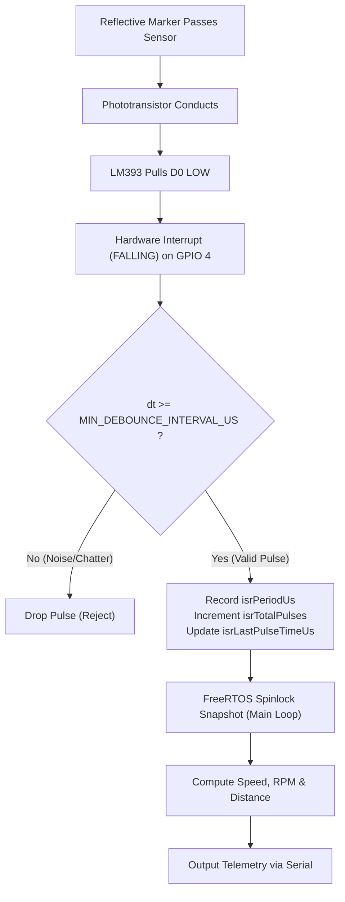

# OptiVelo: ESP32 Optical Bicycle Speedometer & Tachometer

OptiVelo is a low-cost, non-contact bicycle speedometer, tachometer, and odometer built on an ESP32 microcontroller. Instead of relying on fragile mechanical reed switches or expensive dual-microcontroller wireless links (ANT+/BLE), OptiVelo utilizes a discrete 4-pin **TCRT5000 reflective infrared sensor** paired with micro-prismatic retroreflective wheel markers to measure real-time kinematics with microsecond precision.

---

## Key Features

- **Non-Contact Optical Sensing**: Eliminates mechanical reed switch bounce, glass capsule breakage, and spoke magnet misalignment.
- **Edge-Triggered Hardware Interrupts**: Low-latency ISR pinned in `IRAM` triggers on comparator falling edges for real-time edge capture.
- **Software Debounce Lockout**: Microsecond-level validation filters false triggers caused by optical transition noise or spoke reflections.
- **Atomic Concurrency Protection**: FreeRTOS spinlock critical sections (`portMUX_TYPE`) prevent race conditions between ISR and main telemetry loop.
- **Multi-Metric Kinematics**:
  - Real-time linear velocity ($v = \frac{\Delta s}{\Delta t}$) in km/h and m/s.
  - Rotational speed (RPM) and angular velocity ($\omega$) in rad/s.
  - Total cumulative travel distance (odometer) in meters and kilometers.
- **Ambient Sunlight Hardening**: Dedicated optical collimation shrouding and potentiometer threshold tuning overcome daylight infrared saturation.
- **Single-Microcontroller Architecture**: Direct wired routing eliminates battery overhead, pairing delay, and RF interference.

---

## Mathematical Formulation

### 1. Linear Speed
Linear velocity is derived from the wheel circumference and the time interval between consecutive marker pulses:

$$\Delta s = \frac{C_{\text{wheel}}}{P}$$

$$v = \frac{\Delta s}{\Delta t} = \frac{\Delta s}{\Delta t_{\mu s} \times 10^{-6}} \quad [\text{m/s}]$$

$$v_{\text{km/h}} = v \times 3.6$$

*Where:*
- $C_{\text{wheel}}$: Wheel circumference in meters (e.g., $2.070\text{ m}$).
- $P$: Number of reflective markers per revolution (default: $1$).
- $\Delta t$: Elapsed time between consecutive pulses in seconds ($\Delta t_{\mu s} \times 10^{-6}$).

### 2. Rotational Velocity (Tachometer)
Rotational speed in revolutions per minute (RPM) and angular velocity ($\omega$):

$$\text{RPM} = \frac{60}{P \cdot \Delta t} = \frac{60 \times 10^6}{P \cdot \Delta t_{\mu s}}$$

$$\omega = \frac{2\pi \cdot \text{RPM}}{60} \quad [\text{rad/s}]$$

### 3. Cumulative Travel Distance (Odometer)
Total distance traveled calculated by pulse integration:

$$s_{\text{total}} = N_{\text{pulses}} \times \left(\frac{C_{\text{wheel}}}{P}\right) \quad [\text{m}]$$

$$s_{\text{km}} = \frac{s_{\text{total}}}{1000}$$

---

## Hardware Wiring & Pinout

The discrete 4-pin TCRT5000 module incorporates an onboard LM393 voltage comparator and sensitivity potentiometer.

> [!IMPORTANT]
> Always power the TCRT5000 module from the **3.3V rail** on the ESP32. Powering the module from 5V causes the `D0` digital output to output 5V logic, which can damage the ESP32 GPIO pins.

| TCRT5000 Pin | ESP32 GPIO | Description |
| :--- | :--- | :--- |
| **VCC** | **3.3V** | Power supply (3.3V logic level compliance) |
| **GND** | **GND** | Common ground |
| **D0** | **GPIO 4** | Digital comparator output (Interrupt input, `FALLING`) |
| **A0** | **GPIO 34** | Optional analog output (Ambient daylight diagnostics) |

---

## Interrupt & Debouncing Architecture



### Debounce Interval Selection
At a maximum realistic cycling sprint speed of $100\text{ km/h}$ ($27.78\text{ m/s}$) on a $2.07\text{ m}$ wheel:
$$T_{\text{min}} = \frac{2.07\text{ m}}{27.78\text{ m/s}} \approx 74.5\text{ ms}$$

Setting `MIN_DEBOUNCE_INTERVAL_US = 20000` ($20\text{ ms}$) provides safety margin against false optical boundary transitions while supporting speeds up to $372\text{ km/h}$.

---

## Outdoor Reliability & Ambient Sunlight Shielding

The TCRT5000 phototransistor detects near-infrared (peak sensitivity at $\lambda = 950\text{ nm}$). Direct sunlight contains broadband infrared energy that can easily saturate the phototransistor, pulling the output permanently low.

OptiVelo resolves this with a 3-layer mitigation approach:

1. **Physical Optical Shroud (Baffling)**:
   - A matte-black 3D-printed shroud or heat-shrink tube extending $6\text{ to }8\text{ mm}$ past the sensor face restricts the detector field-of-view (FOV), rejecting off-axis ambient solar rays.
2. **High-Contrast Micro-Prismatic Retroreflective Target**:
   - 3M Diamond Grade retroreflective tape reflects incident IR back along the sensor's optical axis with high efficiency, providing an order-of-magnitude higher signal contrast than diffuse wheel paint.
3. **Threshold Tuning via Onboard Potentiometer**:
   - In direct sunlight without the reflective marker in front of the sensor, adjust the multi-turn trimpot until the module's indicator LED just turns off.
   - Verify the LED reliably turns on when the reflective marker sweeps past at a working distance of $5\text{--}12\text{ mm}$.

---

## Configuration & Calibration

Edit the parameters in [SPEEDOMETER.ino](file:///c:/DEV%20AND%20CODING%20C/Cyclometer/Optical-Cyclometer/SPEEDOMETER.ino):

```cpp
// Wheel rollout circumference in meters
constexpr float WHEEL_CIRCUMFERENCE_M = 2.070f; 

// Marker count per wheel rotation (standard = 1)
constexpr uint8_t PULSES_PER_REV = 1;

// Debounce lockout in microseconds
constexpr uint32_t MIN_DEBOUNCE_INTERVAL_US = 20000;

// Stationary timeout (resets velocity to 0 if no pulse is detected)
constexpr uint32_t STOP_TIMEOUT_US = 2500000;
```

### Wheel Circumference Lookup Table

| Tire Size | ISO / ETRTO | Circumference ($C$) |
| :--- | :--- | :--- |
| **$700 \times 23\text{C}$** | $23-622$ | $2.096\text{ m}$ |
| **$700 \times 25\text{C}$** | $25-622$ | $2.105\text{ m}$ |
| **$700 \times 28\text{C}$** | $28-622$ | $2.136\text{ m}$ |
| **$26 \times 1.95$** | $50-559$ | $2.050\text{ m}$ |
| **$26 \times 2.0$** | $52-559$ | $2.070\text{ m}$ |
| **$27.5 \times 2.2$** | $56-584$ | $2.180\text{ m}$ |
| **$29 \times 2.25$** | $57-622$ | $2.288\text{ m}$ |

